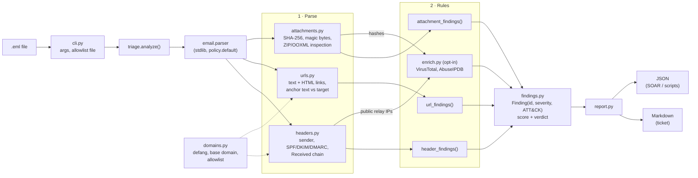

# Architecture

phishtriage is a linear pipeline: one `.eml` goes in, one report dict comes out, and two renderers
turn that dict into Markdown and JSON. The analysers do not depend on each other, so each one can
be tested on its own with a few lines of RFC 5322 text.



## Stages

| Stage | Module | Input → output | Notes |
|---|---|---|---|
| Entry | `cli.py` | argv → `analyze()` call | Reads the file and the allowlist, writes `.md`/`.json` with `-o`. |
| Orchestration | `triage.py` | raw bytes → report dict | The only module that knows about all others. |
| Parse: headers | `headers.py` | `Message` → sender dict, auth dict, hop list | Trusts only the top `Authentication-Results`; takes the client IP from the part of `Received` the MTA wrote, not the HELO. |
| Parse: URLs | `urls.py` | `Message` → URL list, anchor mismatches | `html.parser` from the stdlib, no rendering. Skips `mailto:`, `cid:`, relative links. |
| Parse: attachments | `attachments.py` | `Message` → attachment list | Type from magic bytes; ZIPs are opened read-only to list members, never extracted. |
| Rules | `*_findings()` in each module | parsed data → `list[Finding]` | Pure functions, no I/O. This is where false-positive handling lives (see [RULES.md](RULES.md)). |
| Enrichment | `enrich.py` | hashes, public IPs → intel + findings | Off by default. `fetch` is injectable, so tests never touch the network. |
| Model | `findings.py` | findings → score, verdict, ATT&CK list | Rejects unknown severities and ATT&CK IDs at construction time. |
| Output | `report.py` | report dict → Markdown / JSON | Everything an analyst might click is defanged. |

## Design decisions

- **Parse and judge are separate.** Parsers return plain data that ends up in the JSON report
  unchanged; rules only read it. A rule can be changed or removed without touching parsing, and
  the analyst always sees the raw facts next to the verdict.
- **One rule, one ID.** Every finding has a stable `id` (`url.anchor_mismatch`, …) so SOAR
  playbooks and tests can refer to it, and suppressions can be discussed per rule.
- **Context lowers severity instead of deleting the finding.** Where a signal is weak in context
  (SPF fail on forwarded mail that still passes DMARC, an attached `.msg`), the finding stays in the
  report as `info` with zero score. The analyst can still see it; it just does not move the verdict.
- **The allowlist is the main tuning knob.** It is matched on whole labels (`example.com` matches
  `mail.example.com` but not `example.com.evil.test`) and is consulted by the rules that produced
  most false positives: link disguise, Reply-To, per-URL flags.
- **Standard library only.** No third-party runtime dependencies means nothing to vet before it runs
  on a SOC workstation. The cost is an approximate base-domain function instead of the full Public
  Suffix List.
- **Static and offline by default.** Nothing is fetched, rendered or executed. Enrichment sends only
  SHA-256 hashes and public relay IPs, never message content, URLs or addresses.

## Scoring

```
score   = Σ severity points      high 5 · medium 3 · low 1 · info 0
verdict = score ≥ 10 → likely malicious
          score ≥ 4  → suspicious
          otherwise  → no strong indicators
```

Two independent high findings, or one high plus a few corroborating signals, are needed for
*likely malicious*. A single medium finding on its own stays below *suspicious*. This is a sort key
for the queue, not a classifier.
